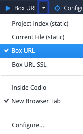

# 1. Run the App

**NOTE: You may find the [Rails guides](https://guides.rubyonrails.org/v7.2/) and the [Rails API reference](https://api.rubyonrails.org/v7.2/) helpful to have on hand.**

Like substantially all Rails apps, you can get this one running by doing these steps:

1. Get your own copy of the [assignment repo](https://github.com/saasbook/hw-rails-wordguesser): fork it on GitHub, then clone your fork (or open your fork in GitHub Codespaces). Don't work directly in the class copy, since you will be submitting this app.

```sh
git clone https://github.com/<your-github-username>/hw-rails-wordguesser.git
```

2. Change into the app's root directory `hw-rails-wordguesser`

3. Install the gems the app depends on, telling Bundler to leave out the `production` group (this is the current spelling of the older `bundle install --without production`):

```sh
bundle config set --local without production
bundle install
```

4. Start the server:

| Local computer | Docker, Codespaces, or Codio |
|-----|------|
| `bin/rails server` | `bin/rails server -b 0.0.0.0` |

The `-b 0.0.0.0` in the right-hand column matters whenever the app runs somewhere other than your own machine. By default the app server only accepts connections from the machine it is running on, so a container would refuse the request your browser makes from outside it. `0.0.0.0` tells it to accept connections on every network interface.

5. See the app in your browser:

| Local computer | Docker, Codespaces, or Codio |
|-----|------|
| Open a fresh browser tab and visit `localhost:3000`. | Your app is running inside a container or on a remote machine, so you reach it through a forwarded port rather than directly. <br><br> **Docker:** start the container with `-p 3000:3000`, then visit `localhost:3000` in your own browser. <br><br> **Codespaces:** the port is forwarded for you as soon as the server starts, and a notification offers to open it. If you dismissed that notification, open the **Ports** panel, find port 3000, and click the globe icon to open it in your browser. If port 3000 isn't listed at all, click **Forward a Port** and enter `3000`. <br><br> **Codio:** click the "Box URL" button on the top toolbar, which is pre-configured to point at port 3000. Set it to open in a new browser tab rather than a Codio tab, as the latter doesn't always work. <br><br>  |

If you are setting up Docker or Codespaces for the first time, `DEVELOPING.md` in the repo walks through each option.

### Self Check Questions

**Q1.1.**  What is the goal of running `bundle install`?

**Q1.2.**  Why is it good practice to leave out the `production` group (`bundle config set --local without production`) when installing the gems on your development computer?

**Q1.3.**
(For most Rails apps you'd also have to create and seed the development database, but like the Sinatra app, this app doesn't use a database at all.)

Play around with the game to convince yourself it works the same as the Sinatra version.

---

[← Wordguesser on Rails](01-Wordguesser-on-Rails.md) | [Contents](README.md) | [2. Where Things Are →](03-2--Where-Things-Are.md)
